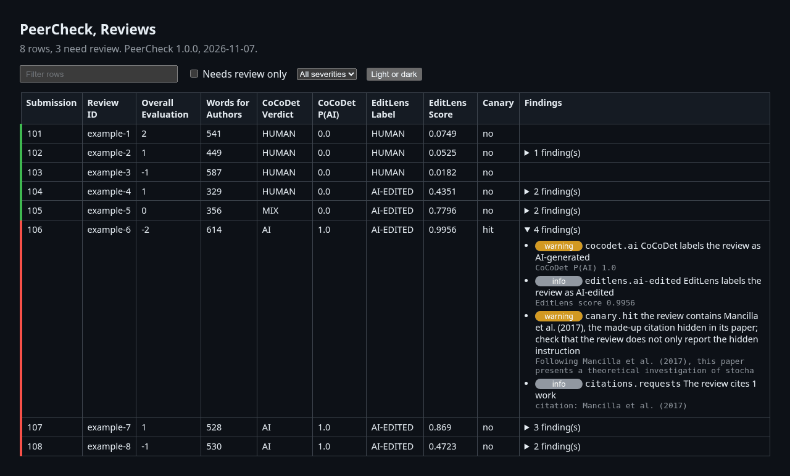

<h1 align="center">PeerCheck</h1>

<p align="center">PeerCheck automatically checks submissions, reviews, and conflicts of interest for conferences and journals.</p>

<p align="center">
  <a href="https://github.com/aalramadan/PeerCheck/actions/workflows/tests.yml"></a>
  
  <a href="https://github.com/aalramadan/PeerCheck/releases/latest"></a>
  <a href="LICENSE"></a>
  
</p>

It reports format violations, anonymity leaks, hidden text, unverifiable references, potentially AI-generated
reviews, and conflicts of interest.

> [!IMPORTANT]
> PeerCheck assists program chairs. A human should verify every flagged paper or review.

## 🎬 Demo

These two report pages show PeerCheck on the made-up papers and reviews in [`examples/`](examples/), whose README
gives the commands.

> [!TIP]
> The [live demo](https://aalramadan.github.io/PeerCheck/) shows the full reports with their Excel workbooks,
> together with a review export of HotCRP and the conflict check. The reports sit in [`examples/reports/`](examples/reports/).

#### Papers


#### Reviews



## 📦 Install

- PeerCheck is tested on Linux, including WSL on Windows.
- The first review run downloads the two AI detectors, about 2 GB.

#### 🐳 Docker

```bash
docker pull ghcr.io/aalramadan/peercheck   # includes Java, Perl, and poppler
docker run --rm -v peercheck-cache:/cache ghcr.io/aalramadan/peercheck setup   # once, about 1.1 GB
```

#### 🐍 Python

```bash
sudo apt install python3-venv perl poppler-utils default-jre   # Debian or Ubuntu
git clone https://github.com/aalramadan/PeerCheck.git && cd PeerCheck
python3 -m venv .venv && . .venv/bin/activate                  # Python 3.10 or newer
pip install -e ".[reviews]"                                    # [reviews] adds the AI detectors of reviews
peercheck setup                                                # once, the reference database, about 1.1 GB
```

#### 🔑 EditLens access

> [!NOTE]
> EditLens needs a free Hugging Face token. Accept its license, which allows non-commercial use only, at
> huggingface.co/pangram/editlens_roberta-large. Then create a read token at huggingface.co/settings/tokens and run
> `export HF_TOKEN=<token>` before PeerCheck or `docker run`. To skip EditLens, add `--detectors cocodet`.

## 🚀 Usage

#### ▶️ Run every check

```text
my-conference/
  venue.yaml     the rules of the venue, a filled copy of profiles/template.yaml
  submissions/   the PDFs of the submissions
  reviews/       the reviews, as EasyChair XML files or the HotCRP review CSV file
```

```bash
cd my-conference
peercheck --profile venue.yaml papers submissions/   # every check of the PDFs, after the submission deadline
peercheck reviews reviews/                           # every check of the reviews, once the reviews are in
```

- The first command writes `report.html` for the browser and `report.xlsx` with every detail. The second writes
  `reviews.html` and `reviews.xlsx`.
- With Docker, write `docker run --rm -v "$PWD:/data" -v peercheck-cache:/cache -e HF_TOKEN
  ghcr.io/aalramadan/peercheck` in place of `peercheck`.

#### 🎛️ Customize

- `venue.yaml` sets the rules of the venue and which checks run, as Venue profiles describes.
- The reference check looks up each cited work in the local copy of DBLP and online in CrossRef, arXiv, Semantic
  Scholar, OpenAlex, and other databases. Two lines of `venue.yaml` limit the online lookups.

```yaml
checks:
  references:
    online_titles: false   # sends only DOIs and arXiv IDs, never the titles
    online: false          # keeps the reference check offline
```

- Options add inputs, pick the checks, or name the outputs, as in these commands.

```bash
peercheck --profile venue.yaml papers submissions/ --submissions submissions.xlsx   # adds the title check
peercheck --profile venue.yaml papers submissions/ --authors authors.csv            # finds author names in the PDFs
peercheck --profile venue.yaml papers submissions/ --checks layout,references       # runs only these checks
peercheck reviews reviews/ --detectors cocodet                                      # skips EditLens
```

| Option | Commands | What it does |
|---|---|---|
| `--profile` | all, before the command | names the rules of the venue, a filled copy of `profiles/template.yaml` or an example such as `icse-2027`, which `papers` needs |
| `--out` | all | names the Excel workbook, or the folder of marked PDFs for `peercheck canary` |
| `--html` | papers, reviews | names the page for the browser, by default the name of `--out` with `.html` |
| `--json` | papers, reviews | also writes a JSON file |
| `--authors` | papers, conflicts | reads the author list |
| `--submissions` | papers | reads a submission sheet with paper numbers and titles |
| `--checks` | papers, reviews | runs only the checks it names, such as `--checks layout,references`, from the list of checks in `external/README.md` |
| `--detectors` | reviews | picks the AI detectors, `cocodet,editlens` by default |
| `--canaries` | reviews | runs the planted-citation check with the key file of `peercheck canary` |
| `--device` | reviews | runs the detectors on the processor (`cpu`) or the graphics card (`cuda`) |
| `--pc` | conflicts | reads the committee list |
| `--dblp-dump` | conflicts | builds the co-author index from `dblp.xml.gz`, the full download of DBLP at dblp.org/xml |
| `--dblp-index` | reviews, conflicts | reads the index that `--save-index` of `peercheck conflicts` wrote |
| `--years` | conflicts | sets the co-authorship window, 3 years by default |
| `--key` | canary | names the private file that lists the planted citation of each paper |

Run any command with `--help` for every option.

#### 🧰 More commands

```bash
peercheck conflicts --authors authors.csv --pc pc.csv --dblp-dump dblp.xml.gz   # dblp.xml.gz comes from dblp.org/xml
peercheck canary submissions/ --out marked/ --key canaries.csv                    # plants a citation in each PDF
peercheck reviews reviews/ --canaries canaries.csv                                # finds the planted citations
peercheck gui                                                                     # the checks on a page in the browser
```

- With Docker, run `docker run --rm -p 127.0.0.1:8765:8765 -v peercheck-cache:/cache -e HF_TOKEN
  ghcr.io/aalramadan/peercheck gui` and open the address it prints.

> [!TIP]
> Check the original PDFs with `peercheck papers` before `peercheck canary`, since the hidden-text check reports the
> planted citation. Then upload the marked copies to the conference system in place of the originals, before the
> reviewers download the papers.

> [!WARNING]
> Keep the key file of `peercheck canary` private, since it reveals the planted citation of each paper.

#### 📂 Inputs

- PDFs with any file names. A number after paper or submission in a name becomes the paper number, such as 12 in
  `CONF_2027_paper_12.pdf` or `conf2027-paper12.pdf`. A PDF without one gets the next free number, which the Files
  sheet of the report names.
- A submission sheet, any CSV or Excel list with a column of paper numbers, such as # or ID, and a column Title.
- An author list, a CSV or Excel file with the columns paper, first, last, email, and affiliation.
- Reviews, as the XML files of EasyChair, the review CSV file of HotCRP, or any CSV file with the columns paper and
  review (the review ID, such as A) and one column per field of the review form, such as the text of the review.
- A committee list with first, last, email, and affiliation. An optional column
  dblp with the DBLP person ID settles a name that several DBLP authors share.

#### 📖 Reports

- An **error** breaks a stated rule of the venue.
- A **warning** marks a likely problem.
- An **info** note gives context.
- A **red bar** marks a paper or a review with an error or a warning.
- **CoCoDet** labels a review as Human, Mix (partly human and partly AI), or AI. Its label AI marks the review for a
  closer look.
- **CoCoDet P(AI)** is the probability, from 0 to 1, that CoCoDet gives to the label AI.
- **EditLens** labels a review as Human, AI-Edited (human writing that AI edited), or AI, as a second opinion.
- **EditLens Score** runs from 0 for human writing to 1 for AI writing. A score below 0.0971 reads as Human, a
  score of 0.997 or more as AI, and a score between them as AI-Edited.

## 📊 Benchmark

We tested the two AI detectors on 1,409 reviews of ICLR 2017 papers, in three groups.

- 1,014 human reviews, the official reviews in [PeerRead](https://github.com/allenai/PeerRead), a public dataset of
  peer reviews, written in 2016 before AI writing tools.
- 98 polished reviews, each a copy of one of these human reviews that a model polished.
- 297 AI reviews, written by DiffusionGemma 26B, Gemma 4 31B, Mistral Large 4, Nemotron 3 Ultra, and Step 5.

| Written by | Reviews | CoCoDet (AI) | EditLens (AI-Edited) | EditLens (AI) |
|---|---|---|---|---|
| People | 1,014 | 0 | 51 | 0 |
| People, then polished by a model | 98 | 0 | 89 | 0 |
| DiffusionGemma 26B | 58 | 58 | 58 | 0 |
| Gemma 4 31B | 60 | 60 | 60 | 0 |
| Mistral Large 4 | 60 | 52 | 60 | 0 |
| Nemotron 3 Ultra | 60 | 56 | 60 | 0 |
| Step 5 | 59 | 47 | 58 | 0 |
| **Total** | **1,409** | **273** | **436** | **0** |

- CoCoDet caught 273 of the 297 AI reviews (91.9%) and flagged none of the human or polished reviews.
- EditLens, the second detector, labeled 296 of the 297 AI reviews (99.7%) as AI-Edited. It also caught AI
  polishing in 89 of the 98 polished reviews (90.8%). Of the 1,014 human reviews, it labeled 51 (5.0%) as
  AI-Edited.

## 🏛️ Venue profiles

- A **profile** holds the rules of one venue, a conference or a journal, such as its template, page limit, and
  margins. It also decides which checks run and how strict each one is.
- `profiles/template.yaml` lists every rule and option, each commented out with its meaning and its default.
- Two filled copies serve as examples. Each copies the call for papers of its venue and links the call.

| Profile | Venue | Format | Pages |
|---|---|---|---|
| icse-2027 | ICSE 2027 Research Track | IEEE, two columns, US Letter | 10 plus 2 of references |
| fse-2027 | FSE 2027 Research Track | ACM acmsmall, one column | 18 plus 4 of references |

#### ➕ Add a venue

1. Copy `profiles/template.yaml` into the folder of the conference as `venue.yaml`.
2. Remove the `#` before each line that the venue needs and set its value from the call for papers. The lines marked
   required always stay. Each other line names its default.
3. Pass the copy by path, such as `peercheck --profile venue.yaml papers submissions/`.

| Value | Sets | Example |
|---|---|---|
| `name`, `source` | the name of the venue and the address of its call for papers | `Example Conference 2027` |
| `format.style`, `format.columns`, `format.paper_size` | the template, its columns, and the paper size in points | `IEEE`, `2`, and `[792, 612]` for US Letter |
| `format.main_pages`, `format.reference_pages` | the page limit and the extra pages for references only | `10` and `2` |
| `format.margins`, `format.body_font_max` | the margins in points and the largest font size of the body text | `[52, 48, 72, 48]` and `10.5` |
| `checks` | which checks run and their options, such as the hosts that links may name | the comments in the template |

## 🧪 Tests

```bash
python -m pip install -e ".[dev,reviews]"
python -m pytest                                     # offline; GitHub Actions runs it on each push
mvn -f external/submission-checker/pom.xml package   # rebuilds the revised SIGSOFT jar
```

## 🔒 Privacy

- Every check and every model runs locally. The reference check is the only one that sends data out.
- The reference check sends the titles, DOIs, and arXiv IDs of the cited works to CrossRef, arXiv, Semantic Scholar,
  OpenAlex, and other databases. Setting `online_titles` to `false` in `venue.yaml` sends only DOIs and arXiv IDs,
  while `online` set to `false` keeps the check offline.
- `.gitignore` keeps PDFs, review XML files, spreadsheets, and CSV files out of git, except the test fixtures and
  the examples.

## 📄 License

- PeerCheck is licensed under the GNU General Public License version 3.
- `NOTICE.md` lists the tools of other authors with their licenses.
- To cite PeerCheck, use *Cite this repository* on GitHub, which reads `CITATION.cff`.

## 📚 References

1. CoCoDet: Chen et al. 2026. *CoCoNUTS: Concentrating on Content while Neglecting Uninformative Textual Styles
   for AI-Generated Peer Review Detection.* ACL 2026.
   [doi.org/10.18653/v1/2026.acl-long.1240](https://doi.org/10.18653/v1/2026.acl-long.1240)
2. EditLens: Thai et al. 2026. *EditLens: Quantifying the Extent of AI Editing in Text.* ICLR 2026.
   [arxiv.org/abs/2510.03154](https://arxiv.org/abs/2510.03154)
3. Canary check: Rao et al. 2025. *Detecting LLM-generated peer reviews.* PLOS ONE.
   [doi.org/10.1371/journal.pone.0331871](https://doi.org/10.1371/journal.pone.0331871)
4. Canary check: ICML. 2026. *On Violations of LLM Review Policies.* ICML Blog.
   [blog.icml.cc](https://blog.icml.cc/2026/03/18/on-violations-of-llm-review-policies/)
5. Hidden-text phrases: Murray. 2025. *PhantomLint: Principled Detection of Hidden LLM Prompts in Structured
   Documents.* arXiv preprint. [arxiv.org/abs/2508.17884](https://arxiv.org/abs/2508.17884)
6. Duplicates check: Day. 2022. *Exploratory analysis of text duplication in peer-review reveals peer-review fraud
   and paper mills.* Scientometrics 127(10), 5965–5987.
   [doi.org/10.1007/s11192-022-04504-5](https://doi.org/10.1007/s11192-022-04504-5)
7. Limit on citation requests: Wren et al. 2019. *Reviewer-coerced citation: case report, update on journal policy
   and suggestions for future prevention.* Bioinformatics 35(18), 3217–3218.
   [doi.org/10.1093/bioinformatics/btz071](https://doi.org/10.1093/bioinformatics/btz071)
8. Citations of works of the reviewers: Barnett. 2025. *Are peer reviewers influenced by their work being cited?*
   eLife 14. [doi.org/10.7554/eLife.108748](https://doi.org/10.7554/eLife.108748)
